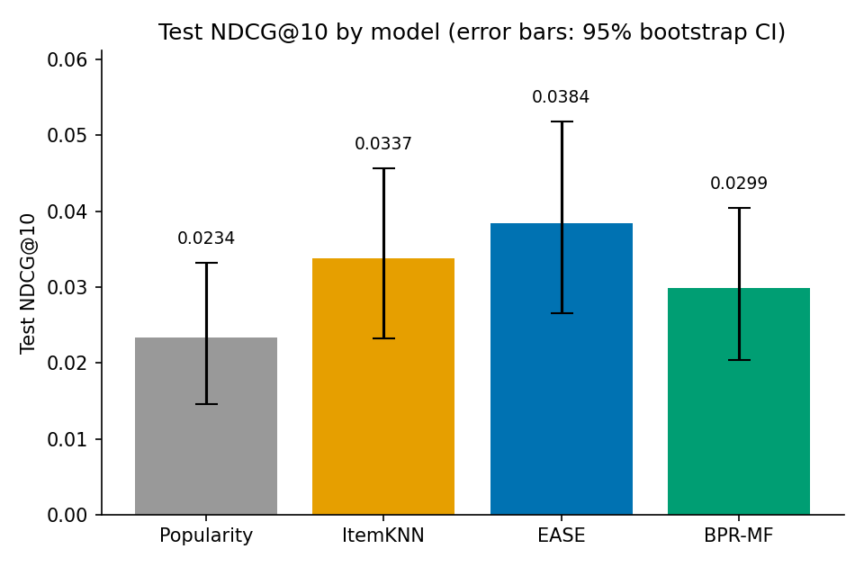
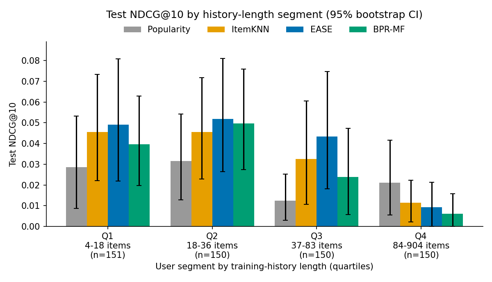

# recsys-experiments

MovieLens(ml-latest-small)에서 Top-K 추천 모델 4개(Popularity · ItemKNN · EASE · BPR-MF)를 **같은 분할 · 같은 평가 · 같은 튜닝 예산**으로 비교한 실험입니다.
"가설 → 실험 → 통계 검정 → 원인 분석" 순서로 정리했습니다.

## 핵심 결과

Test 세트 결과입니다. train+valid로 재학습했고, 이미 본 아이템을 뺀 **전체 아이템을 대상으로 랭킹**했습니다. 사용자 601명, 시드 42입니다.

| 모델 | Recall@10 | NDCG@10 | NDCG@10 95% CI | Recall@20 | NDCG@20 | Coverage@10 |
|---|---|---|---|---|---|---|
| Popularity | 0.0449 | 0.0234 | [0.0145, 0.0332] | 0.0765 | 0.0313 | 0.0307 |
| ItemKNN | **0.0682** | 0.0337 | [0.0232, 0.0457] | **0.1564** | 0.0557 | 0.3524 |
| EASE | 0.0666 | **0.0384** | [0.0265, 0.0519] | 0.1531 | **0.0604** | 0.2573 |
| BPR-MF | 0.0649 | 0.0299 | [0.0204, 0.0405] | 0.1098 | 0.0412 | **0.3985** |



- **Popularity와의 차이가 통계적으로 유의한 모델은 EASE 하나뿐입니다.** NDCG@10 차이는 +0.0150, 95% CI는 [+0.0007, +0.0297], p=0.043입니다. ItemKNN(p=0.139)과 BPR-MF(p=0.291)는 평균이 더 높지만 유의하지 않습니다.
- **개인화 모델 3개 사이에는 유의한 차이가 없습니다.** 비교한 세 쌍의 p-value는 모두 0.19 이상입니다. 그래서 "EASE가 ItemKNN·BPR-MF보다 낫다"고는 말할 수 없습니다. 사용자 601명 × 정답 1개 규모로는 이 정도 차이를 구분할 검정력이 부족합니다.
- **헤비 유저(이력 84개 이상)에서는 개인화 모델 3개 모두 평균이 Popularity보다 낮습니다.** EASE−Popularity 차이는 −0.0119, CI는 [−0.0345, +0.0081]로 유의하지는 않습니다. 다른 세그먼트는 하루 안에 몰아서 남긴 기록인 반면, 이 세그먼트만 이력이 약 60일에 걸쳐 있습니다(아래 4장).
- Coverage는 BPR-MF > ItemKNN > EASE ≫ Popularity 순입니다. 정확도와 다양성이 반대로 움직이는 경향은 보이지만, 정확도 차이 자체가 유의하지 않으므로 trade-off를 확정할 수는 없습니다.

전체 수치는 [`results/results.md`](results/results.md)와 [`results/results.json`](results/results.json)에 있습니다.

---

## 1. 문제 정의

> 사용자의 과거 "좋아요"(평점 4.0 이상) 기록만 보고, **다음에 좋아할 영화 1편**을 Top-10 안에 올릴 수 있는가?

서비스로 치면 "다음에 볼 것 추천"입니다. 암묵적 피드백(클릭·찜처럼 "좋다"는 신호만 있고 "싫다"는 신호는 없는 데이터)을 가정합니다.

## 2. 실험 설계

| 항목 | 선택 | 이유 |
|---|---|---|
| 데이터 | ml-latest-small, 평점 ≥ 4.0만 positive | 실서비스 로그는 대부분 암묵적 피드백입니다. 평점 3 이하를 positive로 넣으면 "봤지만 싫어한 것"까지 정답이 됩니다. |
| 필터링 | 사용자·아이템 모두 positive ≥ 5가 될 때까지 **반복** | 한 번만 거르면 아이템을 지운 뒤 다시 5개 미만이 되는 사용자가 생깁니다. 사용자당 train/valid/test에 최소 1개씩 필요합니다. 결과: 사용자 601 · 아이템 1,955 · positive 41,227 (밀도 3.5088%) |
| 분할 | 사용자별 **시간순 Leave-One-Out** (마지막=test, 직전=valid) | 랜덤 분할은 "미래 기록으로 과거를 맞히는" 누수를 만듭니다. 정렬 키 (userId, timestamp, movieId)로 같은 시각의 기록도 항상 같은 순서가 됩니다. |
| 튜닝 | valid NDCG@10으로 그리드 탐색 → train+valid로 재학습 → test 1회 평가 | test를 튜닝에 쓰지 않습니다. 재학습은 valid 아이템(가장 최근 신호)을 버리지 않기 위해서입니다. |
| BPR 재학습 | valid에서 찾은 `best_epoch_`만큼 고정 학습 | 재학습 때는 조기 종료에 쓸 검증 세트가 없습니다. |
| 평가 | 이미 본 아이템을 −inf로 가리고 **전체 아이템 랭킹** | 정답 1개 + 음성 100개를 뽑는 샘플링 평가는 모델 순위를 뒤집을 수 있습니다 (Krichene & Rendle, 2020). |
| 동점 처리 | **비관적**: 정답과 점수가 같은 아이템은 모두 정답보다 위로 침 | 모든 아이템에 같은 점수를 주는 모델이 운으로 1등을 받는 일을 막습니다. |
| 지표 | Recall@K, NDCG@K (K=10, 20), Coverage@10 | 정답이 1개라 Recall@K = HitRate@K입니다. NDCG는 순위가 높을수록 점수를 더 줍니다. Coverage는 전체 카탈로그 중 누군가에게 한 번이라도 추천된 비율로, 다양성을 봅니다. |
| 통계 검정 | 사용자 단위 **paired bootstrap** 10,000회, 95% CI, 양측 p-value | 같은 사용자에 대한 두 모델의 점수를 짝지어 비교합니다. 그러면 "원래 맞히기 쉬운 사용자"라는 노이즈가 상쇄됩니다. |
| 비교 대상 | valid 1위 모델(EASE) vs 나머지 + H1·H2 판정용 쌍 | test 결과를 보고 기준 모델을 고르지 않도록, 기준 모델은 valid 성적으로 정했습니다. |
| 시드 | 42 고정 (numpy, torch) | 재실행해도 결과가 같은지 확인했습니다. |

### 모델

| 모델 | 한 줄 설명 | 그리드 (최적값) |
|---|---|---|
| Popularity | 아이템별 positive 수로 정렬, 개인화 없음 | – |
| ItemKNN | shrinkage를 준 코사인 유사도, 열마다 상위 k개 이웃만 유지 | neighbors {50,100,200,400} × shrink {0,10,50} → **(50, 0)** |
| EASE (Steck, 2019) | 닫힌 형식 해 B = −P / diag(P), P = (XᵀX + λI)⁻¹, diag(B) = 0 | λ {50,100,250,500,1000,2000} → **50** |
| BPR-MF (Rendle et al., 2009) | 사용자·아이템 임베딩 + 아이템 bias, BPR 손실, Adam(lr 1e-3), 5에폭마다 검증, patience 4 | dim {32,64,128} × weight_decay {1e-5,…,1e-2} → **(32, 1e-3), 115 epoch** |

## 3. 가설과 결과

판정 기준: paired bootstrap에서 95% CI가 0을 포함하지 않으면(p < 0.05) "유의"로 봅니다.

| | 가설 | 결과 (test NDCG@10) | 판정 |
|---|---|---|---|
| H1 | 개인화 모델 > 인기순 | EASE +0.0150 [+0.0007, +0.0297], p=0.043 · ItemKNN +0.0104, p=0.139 · BPR-MF +0.0065, p=0.291 | **부분 확인**: EASE만 유의 |
| H2 | BPR-MF > ItemKNN | −0.0039 [−0.0158, +0.0079], p=0.527 | **기각**: 차이 없음 (평균은 오히려 ItemKNN이 높음) |
| H3 | 정확도와 다양성의 trade-off | NDCG 1위 EASE의 Coverage@10 0.2573 < ItemKNN 0.3524 < BPR-MF 0.3985 | **판단 보류**: 방향은 맞지만 정확도 차이가 유의하지 않음 |
| H4 | 이력이 길수록 개인화 효과(개인화 − 인기순)가 큼 | EASE−Popularity: Q1 +0.0205 · Q2 +0.0203 · Q3 **+0.0310** (유의) · Q4 **−0.0119** | **기각**: Q1~Q3은 양수(Q3만 유의), Q4에서 음수로 뒤집힘. 이력 길이에 따라 커지는 경향 없음 |

### 기각·보류된 가설 해석

**H1이 부분 확인에 그친 이유.**
정답이 사용자당 1개뿐이라 사용자별 NDCG는 대부분 0이고, 맞힌 몇 명만 0보다 큽니다. 점수가 이렇게 0/1에 가까우면 분산이 커서, 사용자 601명으로는 +0.01 정도의 차이를 확신하기 어렵습니다. ItemKNN과 BPR-MF도 평균은 인기순보다 높습니다(각각 +44.4%, +27.8%). 하지만 이 데이터로는 "낫다"고 말할 근거가 부족합니다.

**H2가 기각된 이유.**
행렬 분해(BPR-MF)가 이웃 기반(ItemKNN)보다 낫다는 가정은 이 규모에서는 성립하지 않았습니다. 이는 Dacrema et al.(2019)의 관찰과 같은 방향입니다. 잘 튜닝한 단순한 이웃 기반 모델은 신경망·분해 모델과 비슷하거나 더 좋은 경우가 많습니다. 가능한 원인은 세 가지입니다.
1. 학습 데이터가 4만 건 수준이라, 임베딩을 충분히 학습하기 어렵습니다.
2. 그리드에서 dim이 작을수록(32) 좋았습니다. 모델 용량보다 데이터가 병목이라는 신호입니다.
3. 균등 음성 샘플링은 쉬운 음성(아무도 안 본 영화)이 대부분이라, 학습 신호가 약합니다.

**H3을 보류한 이유.**
Coverage 순서는 가설과 맞습니다. 하지만 비교하려는 정확도 축의 차이가 유의하지 않으므로, "정확도를 희생해 다양성을 얻었다"는 해석은 아직 할 수 없습니다.

## 4. 세그먼트 분석: 헤비 유저에서 무슨 일이 일어났나

사용자를 학습 이력 길이(train+valid)로 4등분했습니다.



| 세그먼트 | 이력 길이 | 사용자 | test 정답의 인기 순위 중앙값 | 이력 중 test 직전 24시간 안의 비율 (중앙값) | 이력 기간, 일 (중앙값) | Popularity | ItemKNN | EASE | BPR-MF | EASE − Popularity (95% CI) |
|---|---|---|---|---|---|---|---|---|---|---|
| Q1 | 4–18 | 151 | 392 | 100% | 0.0 | 0.0285 | 0.0455 | 0.0490 | 0.0396 | +0.0205 [−0.0131, +0.0557] |
| Q2 | 18–36 | 150 | 299 | 100% | 0.0 | 0.0315 | 0.0455 | 0.0518 | 0.0498 | +0.0203 [−0.0133, +0.0536] |
| Q3 | 37–83 | 150 | 500 | 100% | 0.2 | 0.0124 | 0.0325 | 0.0434 | 0.0238 | **+0.0310 [+0.0086, +0.0574]** |
| Q4 | 84–904 | 150 | 578 | **4%** | **59.8** | 0.0211 | 0.0114 | 0.0092 | 0.0062 | −0.0119 [−0.0345, +0.0081] |

(인기 순위 1 = train+valid에서 positive가 가장 많은 아이템)

### 원인 가설

1. **Q1~Q3의 "시간순 분할"은 사실상 같은 세션 안에서의 분할입니다.**
   이 사용자들은 중앙값 기준으로 모든 기록(100%)이 test 직전 24시간 안에 있고, 이력 전체 기간도 0~0.2일입니다. 가입 직후 영화 여러 편에 몰아서 평점을 매긴 것으로 보입니다. 그래서 test 아이템은 학습 이력과 같은 취향·같은 맥락에서 나옵니다.
   반면 Q4는 이력의 4%만 test 근처에 있고, 이력 전체 기간은 중앙값 약 60일입니다. Q4에서만 "시간이 지난 뒤의 다음 행동"을 맞히는 진짜 미래 예측 문제가 됩니다.
2. **오래된 취향이 현재 취향을 덮어씁니다.**
   ItemKNN과 EASE의 점수는 "본 아이템들과의 유사도 합"입니다. 기록이 수백 개면 몇 주~몇 달 전의 취향이 최근 몇 개의 신호보다 훨씬 큰 비중을 차지합니다. 세 모델 모두 최근 기록에 가중치를 더 주는 장치(시간 감쇠, 순서 모델링)가 없습니다.
3. **정답 아이템이 더 롱테일입니다.**
   Q4의 test 정답은 인기 순위 중앙값이 578위로, Q1(392위)·Q2(299위)보다 덜 유명한 영화입니다. 헤비 유저는 이미 유명작을 대부분 봤기 때문에, 남은 후보 중 정답 찾기가 원래 더 어렵습니다.
4. (주의) Q4의 차이는 CI가 0을 포함하므로, "개인화가 인기순보다 나쁘다"고 결론 내리면 안 됩니다. 확실한 것은 **"Q3까지 보이던 개인화 이득이 Q4에서는 사라진다"**는 점입니다.

### 정성 예시 (EASE, 이력 길이가 중앙값에 가장 가까운 사용자)

user 11 (이력 36개)의 최근 좋아요: *Amistad · Good Will Hunting · Dead Man Walking · Sling Blade · Contact* (모두 1990년대 후반 드라마).
EASE Top-10: Schindler's List, Crimson Tide, Star Wars IV, Dances with Wolves, Hunt for Red October, Fargo, Die Hard 2, The Matrix, 12 Monkeys, Batman Forever.
실제 정답: **There's Something About Mary (1998)** → EASE 순위 **404위**.

추천 목록은 이력과 같은 시대·같은 장르(진지한 90년대 영화)로 일관성이 있습니다. 그런데 정답은 갑자기 코미디였습니다. 이처럼 정답 1개짜리 평가는 "합리적이지만 빗나간 추천"을 0점으로 셉니다. 이것도 평가 노이즈의 한 원인입니다.

### 다음 실험 아이디어

| 아이디어 | 검증할 가설 | 성공 기준 |
|---|---|---|
| 시간 감쇠 가중치 (최근 기록에 exp(−Δt/τ) 가중) 적용 ItemKNN/EASE | 원인 2: 오래된 취향이 Q4 성능을 떨어뜨린다 | Q4 NDCG@10이 유의하게 개선되고, Q1~Q3은 유지 |
| SASRec 등 순서 기반 모델 | 다음 아이템은 직전 몇 개의 순서에 크게 의존한다 | Q4에서 EASE 대비 유의한 개선 |
| "세션 경계"를 고려한 분할 (test를 마지막 세션 전체로) | 원인 1: 현재 분할은 Q1~Q3을 쉽게 만든다 | 분할을 바꾸면 세그먼트 간 격차가 줄어드는지 |
| 인기도 기반 음성 샘플링 / 더 큰 데이터(ml-1m, ml-25m)에서 BPR | H2 기각이 데이터 부족 때문인가 | 데이터가 커질수록 BPR−ItemKNN 차이가 양수로 이동 |

## 5. 한계

- **평가 노이즈**: test는 사용자당 1개, 총 601개입니다. 모델 평균 NDCG@10의 95% CI 폭이 ±0.01 수준이라, 모델 간 차이(0.004~0.009)보다 큽니다. 비교 6쌍에 다중 비교 보정(예: Bonferroni, 기준 0.05/6 ≈ 0.008)을 하면 EASE vs Popularity(p=0.043)도 유의하지 않습니다.
- **검증 세트도 같은 노이즈를 가집니다**: 그리드 안의 valid NDCG 차이(예: EASE λ=50과 250은 0.0473 vs 0.0468)는 노이즈 범위 안입니다. 따라서 선택된 하이퍼파라미터가 "진짜 최적"이라는 보장은 없습니다.
- **튜닝 범위**: EASE(λ=50)와 ItemKNN(neighbors=50)의 최적값이 그리드의 **경계**에 있습니다. 범위를 더 낮게 넓히면 성능이 더 오를 수 있습니다. BPR-MF는 lr·배치 크기·음성 샘플링 방식을 고정했으므로, BPR에 불리한 비교일 수 있습니다.
- **오프라인 지표의 한계**: 사용자가 실제로 본(평점을 남긴) 것만 정답으로 칩니다. 추천했다면 좋아했을 영화는 측정할 수 없고, 노출 편향(인기작일수록 평점이 많음)도 보정하지 않았습니다. 온라인 A/B 테스트의 CTR·체류시간과 순위가 다를 수 있습니다.
- **데이터 특성**: ml-latest-small은 가입 직후 몰아서 평점을 매기는 패턴이 강합니다(4장). 실서비스의 연속적 행동 로그와는 시간 구조가 다릅니다.

## 6. 실행 방법

Python 3.10+이 필요합니다.

```bash
make install   # pip install -e ".[dev]"
make data      # data/raw/ 에 ratings.csv, movies.csv 다운로드
make test      # pytest
make run       # 전체 실험 (CPU 약 2분) → results/
```

`make`가 없다면 (예: Windows):

```bash
python -m pip install -e ".[dev]"
python scripts/download_data.py
python -m pytest -q
python scripts/run_experiments.py
```

MovieLens 데이터는 라이선스상 재배포가 제한되어 저장소에 포함하지 않았습니다(`data/`는 `.gitignore` 처리).

## 7. 프로젝트 구조

```
recsys-experiments/
├── scripts/
│   ├── download_data.py      # MovieLens 다운로드
│   └── run_experiments.py    # 그리드 → 재학습 → test → bootstrap → 세그먼트 → 리포트
├── src/recsys/
│   ├── data.py               # positive 추출, 반복 필터링, 시간순 Leave-One-Out
│   ├── metrics.py            # Recall@K, NDCG@K, Coverage@K (비관적 동점 처리)
│   ├── evaluate.py           # 본 아이템 마스킹 + 전체 랭킹 평가
│   ├── stats.py              # paired bootstrap, bootstrap CI
│   └── models/
│       ├── base.py           # Recommender ABC: fit / score / recommend
│       ├── popularity.py
│       ├── itemknn.py
│       ├── ease.py
│       └── bpr.py            # PyTorch BPR-MF + 조기 종료
├── tests/                    # 누수, 필터링, 지표, 동점, 본 아이템 미추천, bootstrap
├── results/                  # results.md, results.json, *.png, run.log
├── DECISIONS.md              # 설계 결정과 기각한 대안
├── pyproject.toml · Makefile · LICENSE
```

## 8. 참고 문헌

- Steck, H. (2019). *Embarrassingly Shallow Autoencoders for Sparse Data.* WWW.
- Rendle, S., Freudenthaler, C., Gantner, Z., & Schmidt-Thieme, L. (2009). *BPR: Bayesian Personalized Ranking from Implicit Feedback.* UAI.
- Krichene, W., & Rendle, S. (2020). *On Sampled Metrics for Item Recommendation.* KDD.
- Ferrari Dacrema, M., Cremonesi, P., & Jannach, D. (2019). *Are We Really Making Much Progress? A Worrying Analysis of Recent Neural Recommendation Approaches.* RecSys.
- Harper, F. M., & Konstan, J. A. (2015). *The MovieLens Datasets: History and Context.* ACM TiiS 5(4).

## License

코드는 MIT License입니다. MovieLens 데이터는 이 라이선스의 대상이 아니며 GroupLens의 이용 약관을 따릅니다. 자세한 내용은 [LICENSE](LICENSE)를 보세요.
