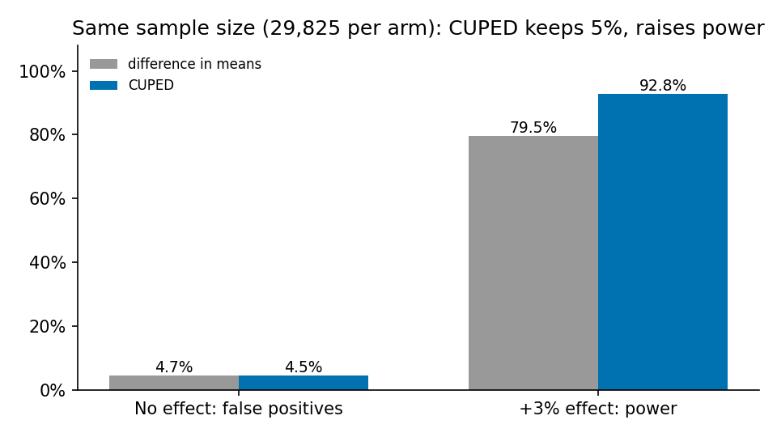
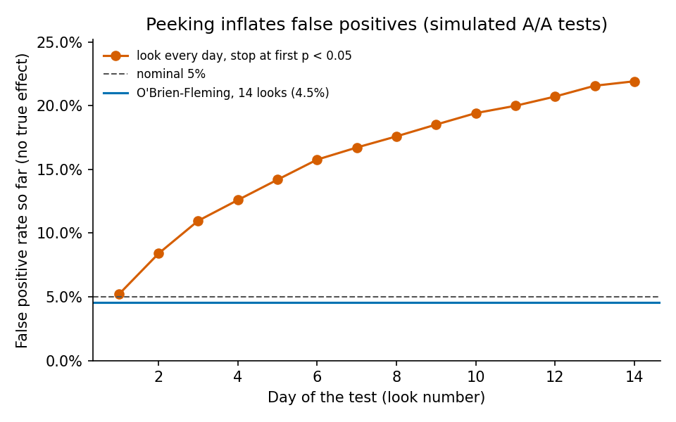

# A/B 테스트 분석: 검정력, CUPED, 중간 엿보기, SRM

중고거래 앱의 "사용자당 주간 채팅 수"처럼 꼬리가 긴 지표를 흉내 낸 **시뮬레이션**으로, 온라인 실험에서 자주 생기는 함정 네 가지를 수치로 확인했습니다.
실제 회사 데이터가 아닙니다. 시나리오마다 실험 4,000개를 시뮬레이션했고, 모든 비율에 95% Wilson 신뢰구간을 붙였습니다.

> **한 줄 요약:** CUPED로 같은 검정력에 필요한 표본을 **35%** 줄였고, 매일 결과를 보고 멈추면 거짓 양성이 **4.6% → 21.9%**로 뛰는 것을 O'Brien-Fleming 경계로 4.5%까지 되돌렸습니다.
> 반대로 "SRM 검정이 조용하면 안전하다"는 가정은 **기각**했습니다. 헤비 유저 일부가 빠지는 버그는 효과 추정을 −3.7% 틀어지게 했지만, SRM 경보는 20%만 울렸습니다.

## 설정

| 항목 | 값 |
|---|---|
| 지표 | 실험 기간 사용자당 활동량 Y. log Y ~ 정규분포 (평균 4.48, 표준편차 5.86, 꼬리가 김) |
| 사전 지표 | 실험 전 같은 지표 X. 원 척도 상관 0.59 (CUPED에 사용) |
| 목표 탐지 크기 (MDE) | 대조군 평균의 +3% |
| 유의수준 / 목표 검정력 | 0.05 양측 / 80% |
| 공식 표본 크기 | 군당 29,825명 (CUPED 적용 시 19,422명) |
| 시뮬레이션 | 시나리오당 4,000회, 시드 42 |

## 가설과 결과

실행 전에 가설과 판정 기준을 정했습니다. 수치는 [`results/abtest/results.md`](../results/abtest/results.md)에서 가져왔습니다.

| | 가설 | 결과 | 판정 |
|---|---|---|---|
| A1 | 표본 크기 공식이 시뮬레이션에서도 검정력 80%(±2%p)를 낸다 | 79.5% [78.3, 80.8] · CUPED 공식 크기에서 78.9% [77.6, 80.1] | **확인** |
| A2 | CUPED는 거짓 양성을 5%로 유지하면서 분산을 약 ρ²만큼 줄인다 | 거짓 양성 4.4% [3.9, 5.1] · 분산 비율 0.654 (이론 1−ρ² = 0.651) · 같은 표본에서 검정력 79.5% → 92.8% | **확인** |
| A3 | 매일 엿보다 p < 0.05에서 멈추면 거짓 양성이 15%를 넘고, O'Brien-Fleming 경계로 5% 근처로 돌아온다 | 21.9% [20.7, 23.2] → 4.5% [3.9, 5.2] | **확인** |
| A4 | 실험군 헤비 유저의 일부가 로그에서 빠지면 SRM 검정이 90% 이상 잡아낸다 | SRM 경보 20.3% [19.1, 21.6] | **기각** |

### A2: CUPED



CUPED(Deng et al., 2013)는 Y − θ(X − X̄)를 비교합니다. θ = cov(X, Y) / var(X)입니다.
X는 배정 전에 측정했으므로 처치와 독립이라, 효과 추정에 편향을 만들지 않고 X로 설명되는 분산만 덜어 냅니다.
줄어드는 분산의 비율은 이론상 ρ² = 0.349이고, 시뮬레이션에서는 1 − 0.654 = 0.346이었습니다.

### A3: 중간 엿보기



효과가 없는 A/A 실험에서도 매일 결과를 보고 처음 p < 0.05가 나올 때 멈추면, 14일째에는 실험의 21.9%가 "유의"로 끝납니다.
O'Brien-Fleming 경계는 초반에 매우 엄격하고(1일째 |z| ≥ 7.88), 마지막 날에는 1.96에 가깝습니다(2.10).
경계 상수는 독립 증분 구조를 이용한 몬테카를로로 맞췄습니다. 대가는 작습니다. 효과가 있을 때 검정력은 끝에 한 번 볼 때 77.2%, 경계를 쓸 때 75.9%입니다.

### A4: SRM이 놓치는 버그

| 상황 | 실험군 손실 | 효과 추정 평균 (진짜 효과 0) | 거짓 양성 | SRM 경보 (p < 0.001) |
|---|---|---|---|---|
| 정상 | 0% | +0.02% | 5.2% | 0.2% |
| 버그 | 2% (사전 활동 상위 10% 중 20%) | **−3.67%** | **94.0%** | **20.3%** |

버그는 실험군에서 사전 활동 상위 10% 사용자의 20%가 로그에서 빠지게 했습니다. 실험군 인원의 2%만 줄어서 인원 비율 검정(SRM)은 대부분 조용합니다.
그런데 빠진 사람이 활동량이 큰 사용자라, 효과 추정은 −3.7%로 목표 탐지 크기(3%)보다 크게 틀어졌습니다.
**판단:** 인원 비율만 보는 SRM 점검으로는 부족합니다. 사전 지표 X의 군간 균형 검정, 세그먼트별 SRM을 함께 봐야 합니다.

## 한계

- 데이터는 로그정규 시뮬레이션입니다. 실제 지표에는 요일 효과, 신규 효과(novelty), 사용자 간 간섭(중고거래의 판매자-구매자 상호작용)이 있고, 이 분석은 그것을 다루지 않습니다.
- 사용자 단위 평균 지표만 다뤘습니다. 클릭률 같은 비율 지표(분자·분모가 모두 확률변수)는 델타 방법이 필요합니다.
- A3의 사용자는 고르게 들어온다고 가정했습니다. 실제로는 헤비 유저가 먼저 들어오는 경향이 있어, 초반 엿보기는 더 위험할 수 있습니다.
- A1(79.5%)과 A3의 "끝에 한 번"(77.2%)은 같은 설정이지만 신뢰구간이 거의 닿을 만큼 차이가 납니다. 서로 다른 몬테카를로 표본이라 생긴 차이로 보지만, 반복 횟수를 늘려 확인하지는 않았습니다.

## 실행

```bash
python scripts/run_abtest.py     # CPU 약 4분 → results/abtest/
python -m pytest -q tests/test_abtest.py
```

코드: [`src/recsys/abtest/sim.py`](../src/recsys/abtest/sim.py) (시뮬레이터), [`src/recsys/abtest/analysis.py`](../src/recsys/abtest/analysis.py) (Welch z, CUPED, 표본 크기, O'Brien-Fleming 경계, SRM).

## 참고 문헌

- Deng, A., Xu, Y., Kohavi, R., & Walker, T. (2013). *Improving the Sensitivity of Online Controlled Experiments by Utilizing Pre-Experiment Data.* WSDM.
- O'Brien, P. C., & Fleming, T. R. (1979). *A Multiple Testing Procedure for Clinical Trials.* Biometrics.
- Kohavi, R., Tang, D., & Xu, Y. (2020). *Trustworthy Online Controlled Experiments.* Cambridge University Press.
- Fabijan, A., et al. (2019). *Diagnosing Sample Ratio Mismatch in Online Controlled Experiments.* KDD.
