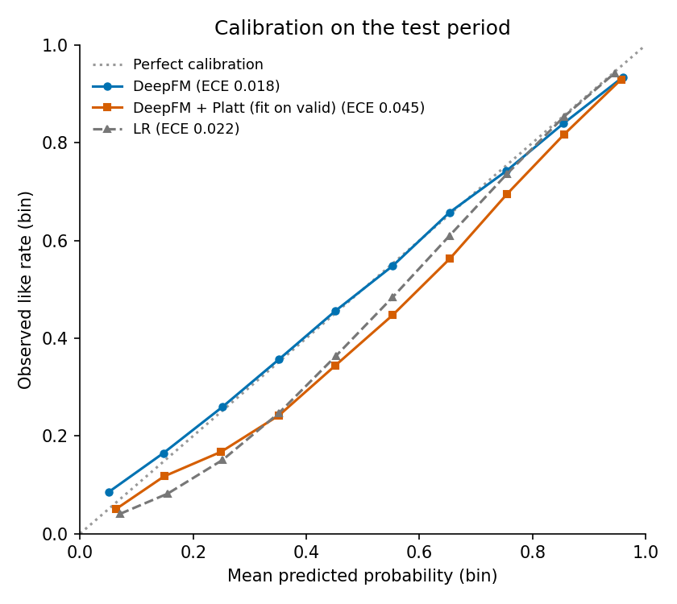
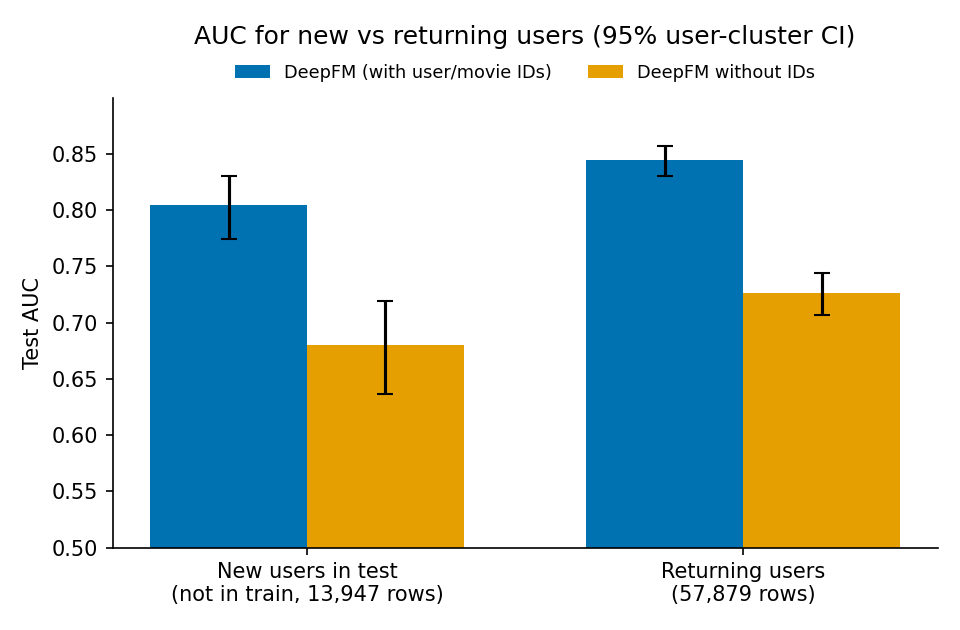

# 5부: CTR 예측 — 순서(AUC)와 확률(보정)을 함께 보기 (ml-1m)

광고·피드 랭킹의 핵심인 "반응 확률(pCTR) 예측"을 LR · FM · DeepFM · DCN-v2로 비교했습니다.
1~4부처럼 **라벨을 열기 전에 계획을 커밋**했고([`PREREG.md`](PREREG.md), 커밋 `e812aa3`), 실제 서비스처럼 **과거로 학습해 미래를 예측하는 시간순 분할**을 썼습니다.

> **한 줄 요약:** 이 데이터에서는 "사용자가 원래 후한가 + 영화가 원래 좋은가"라는 더하기 효과가 신호 대부분이라, 상호작용·딥 모델의 이득이 유의하지 않았습니다(FM − LR +0.0042, DeepFM − FM −0.0030).
> 더 중요한 발견은 **보정**이었습니다. 검증 기간 데이터로 Platt 보정을 하자 test ECE가 **0.0180 → 0.0452로 오히려 나빠졌습니다.**
> 검증 기간은 신규 사용자가 77%, test는 기존 사용자가 81%였기 때문입니다. **보정 데이터는 서빙 트래픽 구성과 맞아야 하고, 신규·기존 사용자는 따로 다뤄야 합니다.**

## 왜 이 실험인가

- 광고 경매는 "pCTR × 입찰가"로 순위를 정합니다. 그래서 순서만 맞는 모델(AUC 높음)이 아니라 **확률 값이 맞는 모델**(보정 오차 낮음)이 필요합니다.
- 공개된 실제 클릭 로그는 대부분 수 GB라서, CTR 논문들(AutoInt 등)의 ml-1m 설정을 따랐습니다. 평점 4~5는 1, 1~2는 0, 3은 제외입니다. 클릭이 아닌 "좋아함" 라벨이라, 결론은 **모델 구조와 평가 방법**에 대한 것으로 한정합니다.

## 설계

| 항목 | 선택 | 이유 |
|---|---|---|
| 분할 | 전역 시간순 80/10/10 | 랜덤 분할(논문 관례)은 미래 행동이 학습에 섞입니다. 서비스는 과거로 학습해 미래에 씁니다 |
| 분할 구조 | train 592,977행 / valid 74,209행 / test 71,826행. valid의 77.0%, test의 19.4%가 train에 없던 사용자 | 실제 서비스처럼 신규 사용자가 섞입니다 |
| 특성 | user_id, movie_id, 성별, 나이, 직업, 우편번호 앞 3자리, 개봉 연도(5년), 장르(여러 개 → 임베딩 평균) | 어휘는 train에서만 만들고, 처음 보는 값은 "모름" 인덱스로 보냅니다(누수 방지) |
| 모델 | LR, FM, DeepFM, DCN-v2. 임베딩 16, Adam 1e-3, 배치 4,096, valid logloss로 조기 종료 | 하이퍼파라미터는 미리 고정했습니다. "같은 고정 예산"에서의 비교입니다 |
| 지표 | AUC, LogLoss, ECE(10구간), 평균 예측/실제 비율 | 순서와 확률을 함께 봅니다 |
| CI | **사용자 단위 cluster bootstrap** 1,000회 | 같은 사용자의 행은 서로 독립이 아닙니다. 행 단위 bootstrap은 CI를 지나치게 좁게 만듭니다 |

## 결과 (test, 71,826행)

수치는 [`results/ctr/results.md`](../results/ctr/results.md)에서 가져왔습니다.

| 모델 | AUC [95% CI] | LogLoss | ECE [95% CI] | 평균 예측 / 실제 |
|---|---|---|---|---|
| LR | 0.8333 [0.8192, 0.8457] | 0.4077 | 0.0223 [0.0149, 0.0345] | 1.029 |
| FM | **0.8375** [0.8234, 0.8498] | 0.4078 | 0.0217 [0.0172, 0.0331] | 1.027 |
| DeepFM | 0.8345 [0.8208, 0.8463] | **0.4046** | **0.0180** [0.0131, 0.0281] | 1.017 |
| DCN-v2 | 0.8270 [0.8116, 0.8400] | 0.4131 | 0.0208 [0.0130, 0.0312] | 1.020 |
| DeepFM + Platt (valid로 맞춤) | 0.8345 | 0.4098 | 0.0452 [0.0334, 0.0578] | 1.060 |

학습 기록을 보면 최적 epoch이 LR 30(상한), FM 17, DeepFM 4, DCN-v2 1입니다. 파라미터가 많은 모델일수록 빨리 과적합합니다.

## 가설과 판정 (사전 등록)

| | 가설 | 결과 [95% CI] | 판정 |
|---|---|---|---|
| C1 | 상호작용이 중요하다: FM > LR (AUC) | +0.0042 [−0.0005, +0.0090] | **미확인** (경계선) |
| C2 | 딥 모델 > FM (AUC). 딥 모델은 valid logloss로 DeepFM 선택 | −0.0030 [−0.0063, +0.0001] | **기각** |
| C3 | valid로 맞춘 Platt 보정이 test ECE를 줄인다 | **+0.0272** [+0.0138, +0.0312] (악화) | **기각** |
| C4 | 신규 사용자의 AUC가 기존 사용자보다 낮다 | −0.0404 [−0.0703, −0.0098] (신규 0.8042, 기존 0.8446) | **확인** |

### C1·C2: 왜 상호작용·딥 모델이 이득이 없었나

LR에도 user_id와 movie_id 가중치가 있습니다. 즉 LR은 "사용자 편향 + 영화 편향" 모델이고, 그것만으로 AUC 0.833입니다.
FM이 더하는 "특성 쌍의 상호작용"은 +0.004, MLP·Cross layer는 그 위에 아무것도 더하지 못했습니다. 평점 데이터에서는 개인 취향의 상호작용보다 **사용자의 후한 정도와 영화의 품질**이 대부분을 설명한다는 뜻입니다.
딥 모델은 1~4 epoch 만에 과적합했습니다. 하이퍼파라미터를 튜닝하지 않은 비교라는 한계가 있지만, 같은 예산이라면 단순한 모델이 충분했습니다. 1부 H2(BPR-MF ≯ ItemKNN)와 같은 방향입니다.

**학습 시드의 운인가? (사후 점검, [`results/ctr/seeds.md`](../results/ctr/seeds.md))** 같은 분할에서 LR·FM·DeepFM을 시드 5개로 다시 학습했습니다.

| 같은 시드끼리의 AUC 차이 | 평균 | [최소, 최대] | 차이 > 0인 시드 |
|---|---|---|---|
| FM − LR | +0.0033 | [+0.0014, +0.0059] | 5 / 5 |
| DeepFM − FM | −0.0053 | [−0.0114, −0.0006] | 0 / 5 |

방향은 시드와 상관없이 일관됩니다. FM은 늘 LR보다 조금 높고, DeepFM은 늘 FM보다 낮습니다.
다만 시드에 따른 AUC 표준편차가 FM 0.0020, DeepFM 0.0028로 모델 간 차이와 비슷한 크기입니다. 그래서 C1은 사전 등록한 기준(사용자 표본 CI)대로 "미확인"을 유지하고, 이 점검은 보조 근거로만 씁니다.

### C3: 보정이 오히려 나빠진 이유 (사후 분석)



| valid 행 (DeepFM) | 양성 비율 | ECE | 평균 예측 / 실제 |
|---|---|---|---|
| 신규 사용자 (train에 없음) | 0.7904 | 0.0513 | **0.935** (과소 예측) |
| 기존 사용자 | 0.7408 | 0.0107 | 1.010 |

1. **모델은 기존 사용자에게 이미 잘 보정되어 있었습니다.** 문제는 신규 사용자였습니다. user_id가 "모름"이라 평균적인 사용자처럼 예측하는데, 이 시기 신규 사용자는 더 후하게 평점을 줬습니다.
2. **valid 전체로 Platt을 맞추면 신규 사용자에 맞춰 예측을 위로 올립니다**(b = 0.407). 그런데 test는 기존 사용자가 81%라서 과대 예측이 됐습니다(평균 예측/실제 1.017 → 1.060).
3. valid의 **기존 사용자만으로** 보정하면 거의 바뀌지 않습니다(a = 0.942, b = −0.018). test ECE 변화도 −0.0060 [−0.0094, +0.0014]로 유의하지 않습니다. 원래 모델이 이미 잘 맞았다는 뜻입니다.

**교훈:** 보정용 데이터는 **실제 서빙 트래픽의 구성(신규·기존 비율)**과 맞아야 합니다. 신규 사용자 비율이 시기마다 크게 바뀌는 서비스라면, 신규·기존 사용자 보정을 따로 두거나 "신규 여부"를 특성으로 넣는 것이 안전합니다.

### C4: 신규 사용자 (콜드 스타트)



신규 사용자의 AUC가 기존 사용자보다 0.040 낮았습니다(확인). 탐색적으로 ID 특성(user_id, movie_id)을 모두 빼 보니 두 집단 모두 AUC가 약 0.12 떨어졌습니다.
신규 사용자는 user_id가 어차피 "모름"이므로, 신규 사용자에게 떨어진 0.1241은 **movie_id(영화별 품질 신호)**의 몫입니다. 콜드 스타트 사용자에게도 아이템 쪽 신호가 가장 중요했습니다.

## 당근에 적용한다면

- 당근은 신규 가입·신규 동네 사용자가 계속 들어옵니다. 광고 pCTR을 경매에 쓰려면, **신규·기존 사용자별 보정 상태를 따로 모니터링**하는 것이 첫 번째 할 일입니다.
- 오프라인 평가는 랜덤 분할이 아니라 **시간순 분할**로 해야 서빙 때의 분포 변화(신규 사용자 비율, 기준 반응률 변화)가 드러납니다.
- 모델 복잡도를 올리기 전에 "편향(bias) 모델"이 얼마나 설명하는지부터 봅니다. 이 데이터에서는 그것이 대부분이었습니다.

## 계획에서 달라진 점

- 사전 등록한 분석은 그대로 실행했습니다.
- **추가한 것(사후):** C3 원인 분석(valid의 신규·기존 사용자별 보정 상태, 기존 사용자만으로 맞춘 Platt), 학습 시드 5개 점검. 판정에는 쓰지 않았습니다.

## 한계

- 평점은 클릭이 아니고, 사용자가 고른 영화에만 평점이 있습니다(노출 선택 편향).
- 하이퍼파라미터를 튜닝하지 않았습니다. 딥 모델은 정규화·학습률 조정으로 나아질 수 있습니다.
- test 기간(2000-12-29 ~ 2003-02-28)은 길고 행이 적은 사용자 꼬리가 섞여 있습니다.
- 실제 광고 데이터(Criteo, Avazu 등 수 GB)에서의 재현은 하지 않았습니다.

## 실행 방법

```bash
python scripts/download_data.py ml-1m      # users.dat 포함
python -m pytest -q tests/test_ctr.py      # 10개
python scripts/run_ctr.py                  # CPU 약 3분 → results/ctr/
```

## 파일

| 파일 | 내용 |
|---|---|
| `ctr/PREREG.md` | 사전 등록 (라벨을 열기 전 커밋) |
| `src/recsys/ctr/data.py` | 시간순 분할, train 전용 어휘, 장르 다중값 필드 |
| `src/recsys/ctr/models.py` | LR, FM, DeepFM, DCN-v2 (PyTorch), 조기 종료 학습 |
| `src/recsys/ctr/metrics.py` | 가중 AUC·LogLoss·ECE, 사용자 cluster bootstrap, Platt scaling |
| `scripts/run_ctr.py` | 전체 실험과 결과 파일 생성 |
| `scripts/ctr_seeds.py` | 사후 점검: 학습 시드 5개 (약 8분) |
| `tests/test_ctr.py` | AUC 정의 일치, 보정, cluster bootstrap, 시간 분할·어휘 누수, 상호작용 학습, 재현성 |
| `results/ctr/` | results.md, results.json, calibration.png, cold_warm.png, run.log, seeds.md·json·log |
| `ctr/INTERVIEW.md` | 면접 예상 질문과 답 |

## 참고 문헌

- Rendle, S. (2010). *Factorization Machines.* ICDM.
- Guo, H., Tang, R., Ye, Y., Li, Z., & He, X. (2017). *DeepFM: A Factorization-Machine based Neural Network for CTR Prediction.* IJCAI.
- Wang, R., Shivanna, R., Cheng, D., Jain, S., Lin, D., Hong, L., & Chi, E. (2021). *DCN V2: Improved Deep & Cross Network and Practical Lessons for Web-scale Learning to Rank Systems.* WWW.
- Song, W., Shi, C., Xiao, Z., Duan, Z., Xu, Y., Zhang, M., & Tang, J. (2019). *AutoInt: Automatic Feature Interaction Learning via Self-Attentive Neural Networks.* CIKM.
- Platt, J. (1999). *Probabilistic Outputs for Support Vector Machines and Comparisons to Regularized Likelihood Methods.*
- McMahan, H. B., et al. (2013). *Ad Click Prediction: a View from the Trenches.* KDD.
