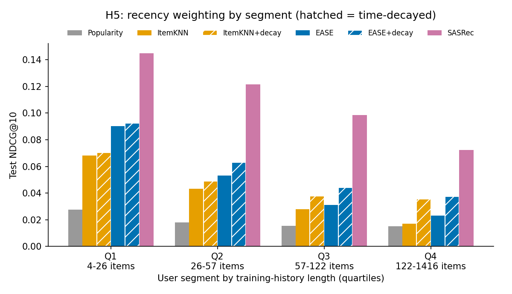

# 2부: ml-1m으로 규모 키우기, SASRec, CPU 서빙

1부(루트 README)는 사용자 601명짜리 ml-latest-small에서 "최근 기록에 가중치를 주면 헤비 유저가 좋아진다"(H5)를 찾았습니다.
2부는 같은 평가 방식을 **10배 큰 ml-1m(사용자 6,034명)**에 적용해 세 가지를 확인합니다. 결과를 재현하는지, 순서를 직접 배우는 딥러닝 모델(SASRec)이 더 나은지, 그 모델을 CPU에서 얼마나 빠르게 서빙할 수 있는지입니다.

> **한 줄 요약:** SASRec이 test NDCG@10 **0.1093**으로 EASE+시간 감쇠(0.0593)를 +0.0499(p<0.001) 앞섰습니다.
> ONNX Runtime int8로 바꿔도 품질은 그대로(차이 +0.0002, p=0.534)이고, CPU 1건 요청 지연시간은 PyTorch 1.48ms → **0.77ms**(p50)로 줄었습니다.

## 가설 (실행 전에 고정)

| | 가설 | 결과 | 판정 |
|---|---|---|---|
| H6 | ml-1m에서도 시간 감쇠가 헤비 유저(Q4)를 유의하게 개선한다 | EASE+감쇠 − EASE, Q4: +0.0145 [+0.0063, +0.0230], p<0.001 | **확인** (단, 아래 "다르게 나온 점") |
| H7 | SASRec은 EASE+시간 감쇠보다 전체 NDCG@10이 유의하게 높다 | +0.0499 [+0.0438, +0.0561], p<0.001. 네 세그먼트 모두 유의 | **확인** |
| H8 | ONNX int8 양자화는 NDCG@10을 유의하게 떨어뜨리지 않으면서 CPU 지연시간을 줄인다 | NDCG@10 +0.0002 [−0.0005, +0.0010], p=0.534 · p50 0.90 → 0.77ms (ONNX fp32 대비) | **확인** |

수치 출처: [`results/ml-1m/results.md`](../results/ml-1m/results.md), [`results/ml-1m/serving/results.md`](../results/ml-1m/serving/results.md).

## 데이터와 설정

- ml-1m, 평점 ≥ 4를 positive로, 사용자·아이템 positive ≥ 5까지 반복 필터링 → 사용자 6,034 · 아이템 3,125 · positive 574,376
- 분할, 평가(전체 아이템 랭킹, 비관적 동점), 튜닝(valid → train+valid 재학습 → test 1회), paired bootstrap은 1부와 같습니다.
- BPR-MF는 뺐습니다. 1부에서 H2가 이미 기각됐고, 2부의 신경망 모델은 SASRec입니다.

## 결과

| 모델 | NDCG@10 | 95% CI | Recall@10 | Coverage@10 |
|---|---|---|---|---|
| Popularity | 0.0190 | [0.0164, 0.0217] | 0.0388 | 0.0371 |
| ItemKNN (k=20) | 0.0391 | [0.0354, 0.0431] | 0.0762 | 0.3821 |
| EASE (λ=250) | 0.0494 | [0.0452, 0.0536] | 0.1014 | 0.2995 |
| EASE + 시간 감쇠 (τ=0.5일) | 0.0593 | | | |
| **SASRec (dim 100)** | **0.1093** | [0.1032, 0.1153] | **0.2108** | **0.6826** |



### 1부와 다르게 나온 점

- **감쇠의 효과가 Q4에만 있지 않았습니다.** 1부에서는 Q1~Q3이 그대로였는데, ml-1m에서는 EASE+감쇠가 Q2(+0.0101)와 Q3(+0.0130)에서도 유의하게 좋아졌습니다. 이 세그먼트의 기록은 거의 모두 test 직전 24시간 안에 있습니다.
  그러니 감쇠의 효과는 "오래된 취향을 줄인다"만으로는 설명되지 않습니다. **같은 세션 안의 순서**도 중요합니다. 순서를 직접 배우는 SASRec이 모든 세그먼트에서 크게 이긴 것과 같은 방향입니다.
- **Q4에서도 개인화가 인기순보다 낫습니다** (EASE 0.0231 vs 0.0153). 1부의 "헤비 유저에서 개인화 효과가 사라진다"는 사용자 150명짜리 세그먼트의 특성이었을 수 있습니다.

## SASRec 구현에서 잡은 버그

첫 학습에서 SASRec의 valid NDCG@10이 인기순 수준(0.022)에서 멈췄습니다. 원인은 초기화였습니다.
PyTorch 임베딩의 기본 초기화는 N(0, 1)인데, 원 논문처럼 임베딩에 √d(≈7)를 곱하자 점수가 너무 커져 학습이 포화됐습니다.
참고 구현처럼 Xavier 초기화로 바꾸자 같은 설정에서 0.1054(60 epoch)까지 올랐습니다.

## H8: CPU 서빙

학습한 SASRec을 ONNX로 내보내고, 가중치를 int8로 동적 양자화했습니다. 같은 test 사용자로 품질을 재고, 사용자 1명씩 1,000번 요청해 지연시간을 쟀습니다(CPU 4스레드, 본 아이템 가리기와 top-10 선택 포함).

| 방식 | test NDCG@10 | 모델 크기 | p50 | p95 | p99 |
|---|---|---|---|---|---|
| PyTorch fp32 | 0.1089 | 1.8 MB | 1.48 ms | 1.97 ms | 2.09 ms |
| ONNX Runtime fp32 | 0.1089 | 3.1 MB | 0.90 ms | 1.27 ms | 1.32 ms |
| **ONNX Runtime int8** | **0.1092** | **0.9 MB** | **0.77 ms** | **1.04 ms** | **1.16 ms** |
| EASE (참고) | 0.0494 | 39.1 MB | 0.08 ms | 0.17 ms | 0.26 ms |

- ONNX fp32는 PyTorch와 점수가 사실상 같습니다(64명 기준 최대 차이 1.1e−5). int8은 NDCG@10 차이가 유의하지 않습니다(p=0.534).
- EASE는 행렬 곱 한 번이라 10배 빠르지만, 아이템 수의 제곱만큼 메모리를 쓰고(39MB) 품질이 절반입니다. 아이템이 수백만 개인 서비스에서는 EASE의 아이템×아이템 행렬을 그대로 쓸 수 없습니다.
- 서빙용으로 다시 학습한 SASRec은 0.1089로, 본 실험(0.1093)과 조금 다릅니다. GPU 연산이 완전히 결정적이지 않아서입니다.
- **잡은 버그:** 처음에는 ONNX 점수가 PyTorch와 달랐습니다. `torch.onnx.export`가 내보낸 래퍼 모듈을 원래 모드로 되돌리는데, 새로 만든 래퍼는 기본이 학습 모드라 안쪽 SASRec까지 학습 모드(드롭아웃 켜짐)로 바뀌었습니다. 래퍼를 평가 모드로 만들어 고쳤고, "내보내기가 모델을 바꾸지 않는다"를 테스트로 고정했습니다.

간단한 추천 API도 있습니다: `python scripts/serve.py` → `GET /recommend/{user}?k=10` (FastAPI, ONNX int8).

## 한계

- SASRec은 너비만 {50, 100} 두 값으로 탐색했고, 최적값 100이 범위 끝입니다. 블록 수, 드롭아웃, 최대 길이는 논문 기본값으로 고정했습니다.
- SASRec은 GPU에서 학습해 다시 돌리면 결과가 조금씩 다릅니다(위 0.1093 vs 0.1089). 시드를 여러 개 돌려 분산을 재지는 않았습니다.
- 지연시간은 한 PC에서 모델 계산만 잰 값입니다. 네트워크, 직렬화, 동시 요청은 포함하지 않았고, 상대 비교용입니다.
- SASRec의 입력은 사용자의 최근 200개 기록입니다. 실서비스에서는 이 시퀀스를 실시간으로 갱신하는 저장소가 필요하고, 그 비용은 재지 않았습니다.

## 실행

```bash
python scripts/download_data.py ml-1m
python scripts/run_experiments.py --dataset ml-1m   # GPU 약 25분 → results/ml-1m/
python scripts/benchmark_serving.py                 # 약 5분 → results/ml-1m/serving/
python scripts/serve.py                             # http://127.0.0.1:8000/recommend/42
```

## 참고 문헌

- Kang, W.-C., & McAuley, J. (2018). *Self-Attentive Sequential Recommendation.* ICDM.
- Harper, F. M., & Konstan, J. A. (2015). *The MovieLens Datasets: History and Context.* ACM TiiS 5(4).
