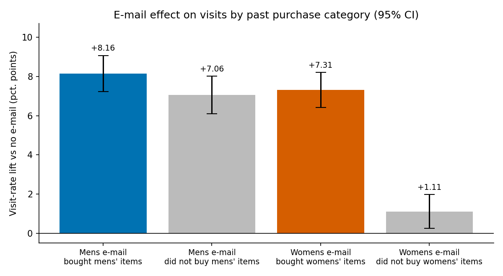
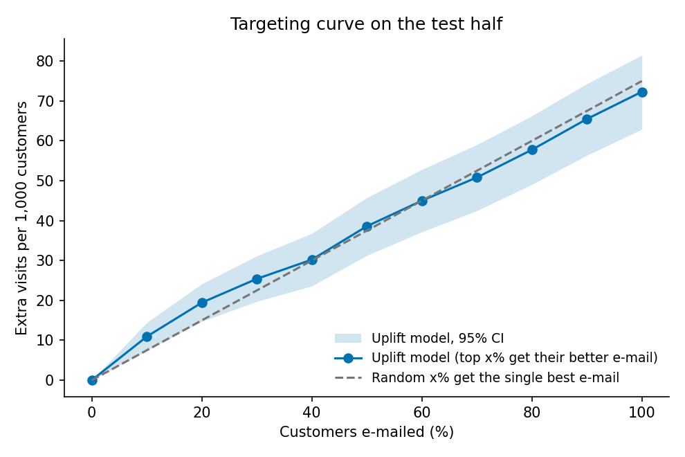

# 4부: 실제 이메일 A/B 테스트 분석과 타겟팅 (Hillstrom)

실제 쇼핑몰의 무작위 이메일 실험 데이터(고객 64,000명, 3군)로 "**설계 → 품질 점검 → 효과 추정 → 이질적 효과 → 타겟팅 정책 평가 → 출시 판단**"을 처음부터 끝까지 진행했습니다.
3부(시뮬레이션)와 달리 참값을 모르는 진짜 데이터입니다. 그래서 **결과를 보기 전에 분석 계획을 커밋**했습니다([`PREREG.md`](PREREG.md), 커밋 `2754f88`).

> **한 줄 요약:** 두 메일 모두 방문율을 크게 올렸습니다(Mens +7.66%p, Womens +4.52%p).
> 고객마다 효과가 다르다는 것도 확인했습니다. Womens 메일은 여성 상품 구매자에게만 효과가 있습니다.
> 그런데 **업리프트 모델로 고객별 메일을 고르는 정책은 "전원에게 Mens 메일"보다 낫지 않았습니다**(−0.27%p, CI [−0.83, +0.29]).
> 사후 분석으로 이유를 찾았습니다. **Mens 메일보다 Womens 메일이 나은 고객 집단이 없었습니다.**
> "효과가 사람마다 다르다"와 "개인화하면 이득이다"는 같은 말이 아닙니다.

## 결론과 권고 (사전에 정한 의사결정 규칙 적용)

| 결과 | 권고 |
|---|---|
| U1 확인, U3 기각 | **모든 고객에게 Mens 메일 발송.** 업리프트 모델은 운영 비용을 정당화할 근거가 없음 |
| U4 기각 | 예산이 절반뿐이어도 모델 상위 50%를 고르는 것이 무작위 선택보다 낫다는 근거 없음 |
| 사후 분석 (가설 생성용) | 남녀 상품을 **둘 다** 산 고객에서 Mens 메일 효과가 가장 큼(+13.44%p). 다음 실험에서 확인할 후보 |

## 데이터와 설계

| 항목 | 내용 |
|---|---|
| 데이터 | Kevin Hillstrom, MineThatData E-Mail Analytics Challenge (2008) |
| 군 | Mens 메일 / Womens 메일 / 미발송, 1:1:1 무작위 배정 |
| 1차 지표 | visit: 발송 후 2주 안에 방문 (대조군 10.62%) |
| 2차 지표 | conversion(구매), spend(구매액). 판정에 쓰지 않음 |
| 다중 비교 | U1, U2 각각 Holm 보정 (비교 2개씩) |
| 업리프트 검증 | 군별 층화 50:50 분할. 모델 선택은 train 안에서 5-fold, test는 한 번만 사용 |
| 정책 가치 | 층화 Hajek 추정 + 고객 단위 paired bootstrap 10,000회 |

## 0. 품질 점검 (통과)

- **SRM:** 군별 인원 21,306 / 21,307 / 21,387명, 카이제곱 0.203, p = 0.904입니다. 경보 기준(p < 0.001)에 해당하지 않습니다.
- **공변량 균형:** 모든 사전 변수의 표준화 평균 차이(SMD)가 최대 0.0137로, 기준 0.1보다 훨씬 작습니다.

## 1. 가설과 결과

수치는 [`results/uplift/results.md`](../results/uplift/results.md)에서 가져왔습니다.

| | 가설 | 결과 | 판정 |
|---|---|---|---|
| U1 | 두 메일 모두 방문율을 높인다 | Mens **+0.0766** [+0.0700, +0.0832] (+72.1%) · Womens **+0.0452** [+0.0389, +0.0516] (+42.6%), Holm p 모두 < 0.001 | **확인** |
| U2 | 효과는 고객이 산 적 있는 상품군과 맞을 때 더 크다 | Womens 메일: 여성 상품 구매자 +0.0731 vs 비구매자 +0.0111, 차이 **+0.0620** [+0.0495, +0.0746], Holm p < 0.001 · Mens 메일: +0.0816 vs +0.0706, 차이 +0.0110 [−0.0023, +0.0242], Holm p = 0.104 | **부분 확인** (Womens만) |
| U3 | 고객별로 메일 종류를 고르는 모델 정책 > 모두에게 같은 메일 | 0.1816 vs 0.1843, 차이 **−0.0027** [−0.0083, +0.0029], p = 0.341 | **기각** |
| U4 | 예산 50%일 때 모델 상위 50%가 전원 발송 증분의 절반보다 많이 얻는다 | 0.0386 / 0.0750 = **0.514** [0.437, 0.594] | **기각** (무작위와 구분 안 됨) |

2차 지표도 같은 방향입니다. 구매율은 Mens +0.0068, Womens +0.0031이고, 구매액은 Mens +$0.770, Womens +$0.424입니다. 모두 95% CI가 0보다 큽니다.

### U2: 효과의 이질성은 분명히 있다



Womens 메일은 여성 상품을 산 적 없는 고객에게 거의 효과가 없습니다(+1.11%p). 반면 Mens 메일은 남성 상품 구매 여부와 상관없이 +7~8%p입니다.

### U3·U4: 그런데 타겟팅은 이득이 없었다

- **모델 선택:** train 5-fold에서 로지스틱 회귀 T-learner(out-of-fold 정책 가치 0.1862)가 그래디언트 부스팅(0.1803)보다 나아서 로지스틱 회귀를 골랐습니다. train에서 더 나은 단일 메일은 Mens였습니다.
- 모델은 test 고객의 33.9%에게 Womens 메일을 고르게 했지만, 방문율은 전원 Mens 발송과 차이가 없었습니다.
- 예산 시나리오(U4)에서도 모델 곡선이 무작위 선과 거의 겹칩니다. 상위 10%에서는 모델이 +0.0109로 무작위(+0.0075)보다 높습니다. 하지만 CI 하한(+0.0074)이 무작위 값과 겹치고, 50%부터는 차이가 사라집니다.



## 2. 원인 분석 (사후, 사전 등록에 없던 분석)

> 아래는 결과를 본 뒤 추가한 **탐색적 분석**입니다. 원인 가설을 세우는 용도이며, 확인된 결론으로 쓰지 않습니다.

**질문:** U2에서 고객별 차이가 분명했는데, 왜 U3에서 고객별로 메일을 골라도 이득이 없었나?

| 과거 구매 | 고객 수 | Mens 메일 효과 | Womens 메일 효과 | **Womens − Mens** |
|---|---|---|---|---|
| 남성 상품만 | 28,818 | +0.0692 | +0.0111 | −0.0581 [−0.0679, −0.0483] |
| 여성 상품만 | 28,734 | +0.0706 | +0.0740 | **+0.0034 [−0.0072, +0.0140]** |
| 둘 다 | 6,448 | **+0.1344** | +0.0711 | −0.0633 [−0.0902, −0.0365] |

1. **메일을 고르는 것으로 이득을 보려면, 다른 메일이 확실히 나은 집단이 있어야 합니다.**
   여성 상품만 산 고객에서도 Womens 메일은 Mens 메일과 비기는 수준입니다(+0.0034, 유의하지 않음). 나머지 두 집단에서는 Mens가 확실히 낫습니다. 그러니 최선의 고객별 선택은 "모두 Mens"와 거의 같고, 모델이 Womens를 고른 33.9%는 기껏해야 본전입니다.
2. **U2의 이질성은 "Womens 메일이 어디서 실패하는가"였지, "Mens보다 나은 곳"이 아니었습니다.**
   개인화의 가치를 정하는 것은 한 처치의 효과 차이가 아니라, **선택지 간 효과 차이의 이질성**입니다.
3. **예산 타겟팅(U4)은 최선 메일의 효과가 사람마다 크게 달라야 이득입니다.**
   Mens 메일 효과는 최근 구매 시점(recency)별로 +0.0704~+0.0850, 구매액(history)별로 +0.0685~+0.0910입니다. 대부분 고객에서 비슷합니다. 효과가 큰 "둘 다 구매" 집단은 전체의 10%뿐입니다. 이 점은 상위 10%에서만 모델 곡선이 무작위보다 높아 보이는 것과도 맞습니다.

### 다음 실험 아이디어

| 아이디어 | 검증할 가설 | 성공 기준 (미리 정함) |
|---|---|---|
| "둘 다 구매" 고객 우선 발송 정책을 새 실험에서 검증 | 사후 분석에서 본 +13.44%p가 우연이 아니다 | 새 데이터에서 이 집단의 Mens 효과가 나머지보다 유의하게 큼 |
| 발송 비용·수신 거부를 넣은 정책 평가 | 비용이 있으면 "보낼 사람 고르기"의 가치가 생긴다 | 기대 이익(증분 구매액 − 비용)이 전원 발송보다 유의하게 큼 |
| Womens 메일 내용 개선 후 재실험 | 여성 상품만 산 고객에게 맞춘 메일은 Mens를 이긴다 | 그 집단에서 Womens − Mens > 0 (CI 하한 > 0) |

### 당근에 적용한다면

채팅·키워드 알림, 동네 소식 푸시처럼 "누구에게 무엇을 보낼까"를 정하는 문제에 같은 절차를 쓸 수 있습니다.
1. 무작위 실험을 먼저 하고, SRM·균형을 점검합니다.
2. 평균 효과를 확인합니다.
3. **선택지 간 효과 차이가 사람마다 다른지** 확인합니다.
4. 그다음에야 개인화 모델의 가치를 test에서 정책 가치로 평가합니다.

푸시는 수신 거부·앱 삭제 같은 가드레일 지표를 반드시 함께 봐야 합니다. 이 데이터에는 그런 지표가 없었습니다.

## 3. 계획에서 달라진 점

- 사전 등록한 분석(U1~U4, 탐색 항목)은 계획대로 실행했고, 바꾼 것은 없습니다.
- **추가한 것:** 2장 원인 분석(사후), 타겟팅 곡선 표의 무작위 기준선 열. 모두 결과를 본 뒤 추가했으므로 판정에 쓰지 않았습니다.

## 4. 한계

- **사전 지식:** 2008년부터 공개된 데이터라 분석자가 알려진 결과를 접했을 수 있습니다. 사전 등록은 분석 방법을 결과에 맞추는 것을 막을 뿐, 사전 지식까지 없애지는 못합니다.
- **가드레일 없음:** 수신 거부·스팸 신고 데이터가 없어 "보낼수록 이득"인 구조입니다.
- **단기 지표:** 2주 방문만 봅니다. 반복 발송의 피로, 장기 이탈은 알 수 없습니다.
- **모델 범위:** T-learner 두 종류만 비교했습니다. X-learner, causal forest 등은 시도하지 않았습니다. 다만 2장 분석상 어떤 모델이든 "메일 고르기"로 얻을 이득의 상한 자체가 작습니다.
- **2008년의 한 쇼핑몰** 데이터입니다. 다른 서비스·채널로 일반화할 수 없습니다.

## 실행 방법

```bash
python -m pip install -e ".[dev,uplift]"
python scripts/download_data.py hillstrom   # 4 MB, SHA-256 확인 (서버가 HTTP만 지원)
python -m pytest -q tests/test_uplift.py
python scripts/run_uplift.py                # CPU 약 15초 → results/uplift/
```

## 파일

| 파일 | 내용 |
|---|---|
| `uplift/PREREG.md` | 사전 등록 (결과를 보기 전 커밋) |
| `src/recsys/uplift/analysis.py` | SRM, SMD, Welch 검정, 상호작용 검정, Holm, T-learner, 정책 가치(Hajek), paired bootstrap |
| `scripts/run_uplift.py` | 전체 분석과 결과 파일 생성 |
| `tests/test_uplift.py` | 정답을 아는 합성 데이터로 검정·정책 가치·모델 확인 (8개) |
| `results/uplift/` | results.md, results.json, segment_effects.png, qini.png, run.log |
| `uplift/INTERVIEW.md` | 면접 예상 질문과 답 |

## 참고 문헌

- Hillstrom, K. (2008). *The MineThatData E-Mail Analytics and Data Mining Challenge.*
- Kohavi, R., Tang, D., & Xu, Y. (2020). *Trustworthy Online Controlled Experiments.* Cambridge University Press.
- Künzel, S. R., Sekhon, J. S., Bickel, P. J., & Yu, B. (2019). *Metalearners for estimating heterogeneous treatment effects using machine learning.* PNAS.
- Radcliffe, N. J. (2007). *Using control groups to target on predicted lift: Building and assessing uplift models.* Direct Marketing Analytics Journal.
- Holm, S. (1979). *A simple sequentially rejective multiple test procedure.* Scandinavian Journal of Statistics.
